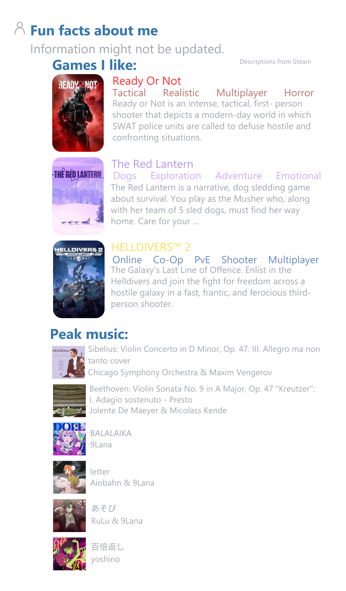

  <!-- Optional Header Banner -->
  <h1>Hello, I'm Michael👋</h1>
  

    A student 🏫 
    Currently Building a Profile Customization Project.  publishing real soon  
    I mostly code in Python :snake: and HTML :five:
  

  
  

 
