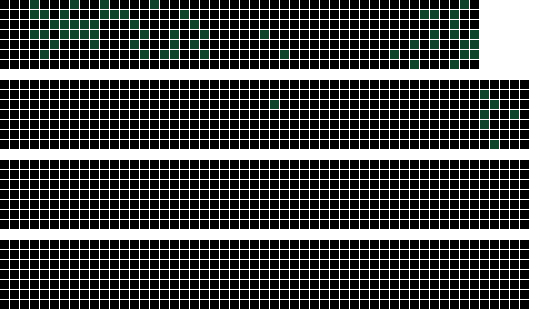
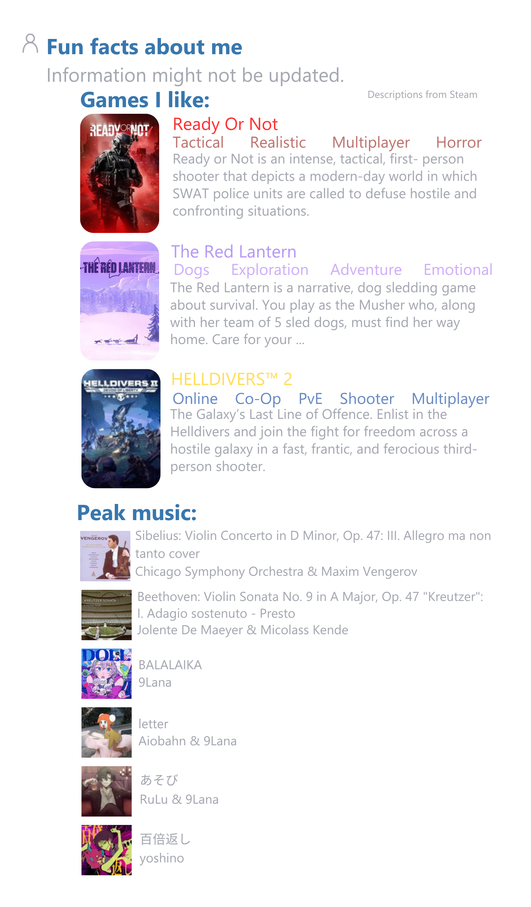

  <!-- Optional Header Banner -->
  <h1>Hello, I'm Michael👋</h1>
  

    A student 🏫 
    <a href="https://github.com/OxidaneCat/Contribution-Graph-Custom-Video">CHECK OUT MY NEWEST & COOLEST PROJECT
    </a> 
    I mostly code in Python :snake: and HTML :five:
  

  
  

 
